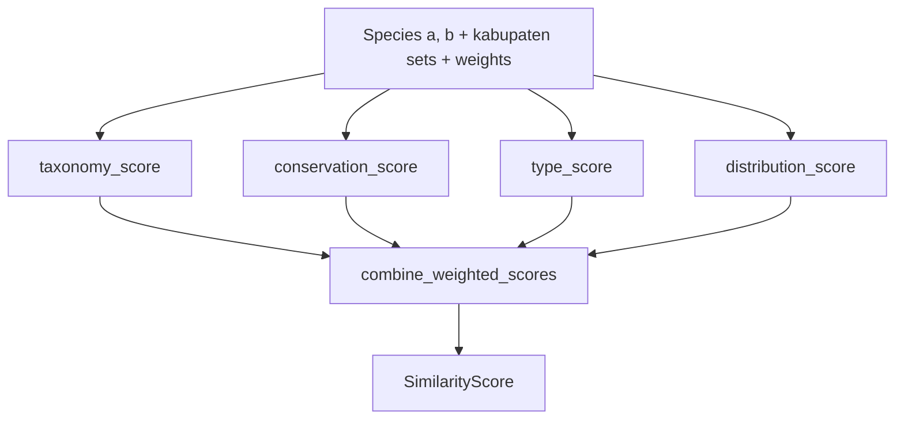

# Pair Similarity — Module 4

> **Status: draft starter — content pending.**

## Overview

`calculate_pair_similarity` menghitung skor kesamaan antara dua spesies
berdasarkan taksonomi, status konservasi, tipe spesies, dan distribusi
kabupaten. Dipakai oleh `compare_species` (via `calculate_all_pairs`) dan
dapat digunakan ulang oleh modul lain.

## Signature

```rust
pub fn calculate_pair_similarity(
    a: &Species,
    b: &Species,
    kabupaten_a: &HashSet<u64>,
    kabupaten_b: &HashSet<u64>,
    weights: &ScoringWeights,
) -> SimilarityScore
```

## Score Components

| Component | Source | Shared helper |
|-----------|--------|---------------|
| `taxonomy_score` | Perbandingan `Taxonomy` a vs b | `calculate_taxonomy_similarity` |
| `conservation_score` | Status IUCN / CITES | internal `score_conservation` |
| `type_score` | `species_type` a vs b | internal `score_species_type` |
| `distribution_score` | Overlap kabupaten | private `score_distribution` → shared `collections::jaccard_similarity` |
| `total_score` | Weighted combination | `combine_weighted_scores` |

## Distribution wrapper

`score_distribution(&HashSet<u64>, &HashSet<u64>) -> f64` sudah
menggunakan `kalimantanbio_shared::collections::jaccard_similarity` secara
langsung. Rumus dan penanganan set kosong tetap milik shared library;
Module 4 tidak membuat implementasi Jaccard kedua atau API publik baru.

Tes unit pada wrapper mencakup set identik (`1.0`), terpisah (`0.0`),
intersection berukuran 1 dari union berukuran 2 (`0.5`), kedua set kosong,
dan satu set kosong dalam kedua urutan argumen (`0.0`).

Wrapper ini belum dihubungkan ke `calculate_pair_similarity` maupun
`compare_species`; kedua entry point tersebut masih berupa stub.

## Species type scoring

Fungsi private `score_species_type(a: &Species, b: &Species) -> f64`
membandingkan kedua field `species_type` setelah memanggil
`kalimantanbio_shared::text::normalize_text`. Hasilnya `1.0` jika sama,
atau `0.0` jika berbeda. Normalisasi tetap milik shared library: huruf
besar/kecil diabaikan, whitespace tepi dihapus, dan whitespace berulang
dirapatkan.

Sesuai aturan kesamaan, dua nilai kosong (termasuk whitespace-only)
menghasilkan `1.0`; nilai kosong dibanding tipe yang terisi menghasilkan
`0.0`. Tidak ada aturan khusus untuk data kosong yang ditambahkan.

Tes mencakup nilai identik, mixed case, whitespace, contoh normalisasi
`"  Pongo  PYGMAEUS "`, tipe berbeda, serta input kosong. Skor diuji dalam
kedua urutan argumen dan data spesies tidak diubah. Fungsi ini belum
dihubungkan ke entry point publik yang masih stub.

## Flow (intended composition)



## Example (intended usage)

```rust,ignore
let score = calculate_pair_similarity(&sp_a, &sp_b, &kab_a, &kab_b, &weights);
println!("{} <-> {}: {:.2}", score.species_a_id, score.species_b_id, score.total_score);
```

## TODO

- [x] Detail rumus `score_species_type`
- [ ] Detail rumus `score_conservation`
- [ ] Batas nilai skor (normalisasi 0..=1)
- [ ] Edge cases: himpunan kabupaten kosong, bobot tidak valid
- [ ] Contoh nyata dengan fixture `shared/fixtures/`
